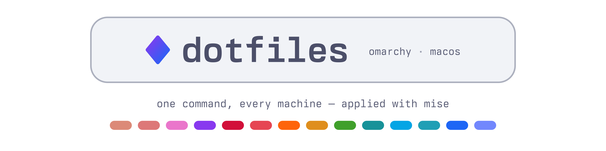
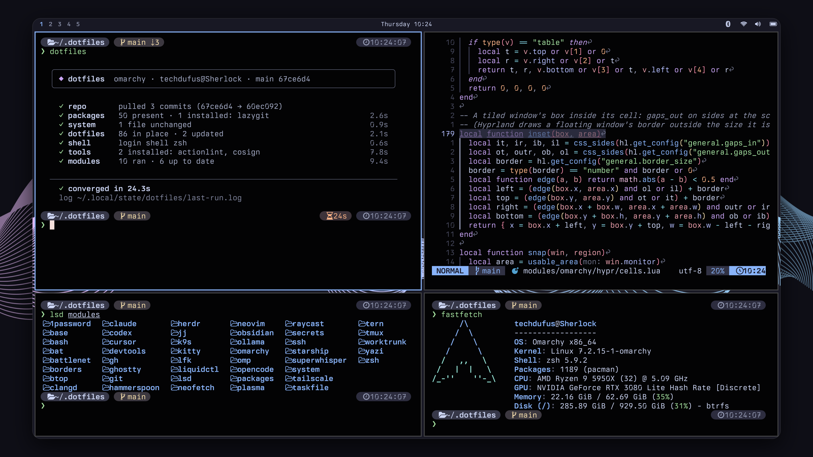
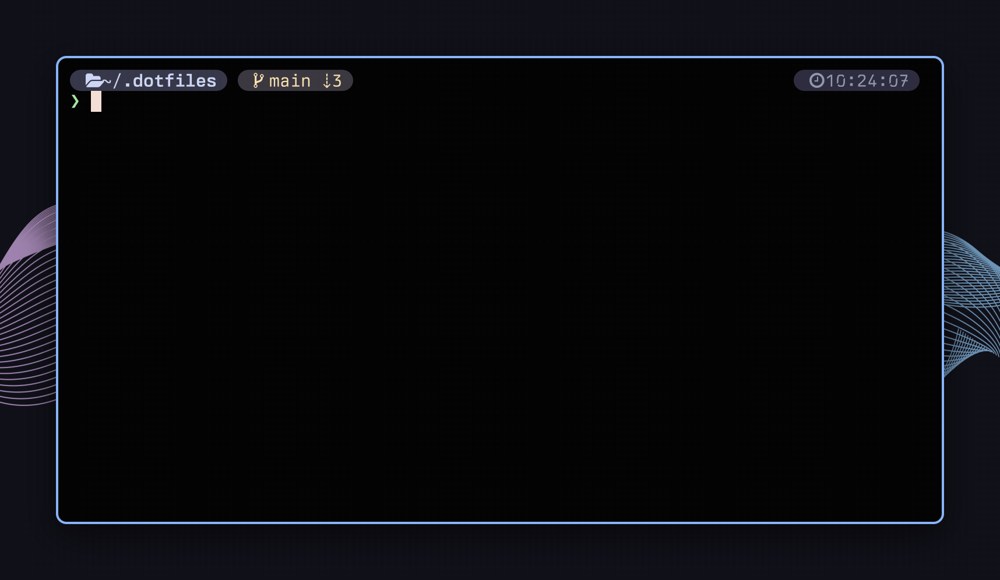
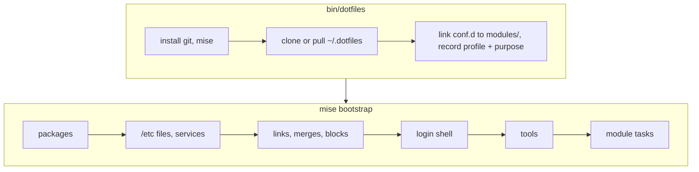
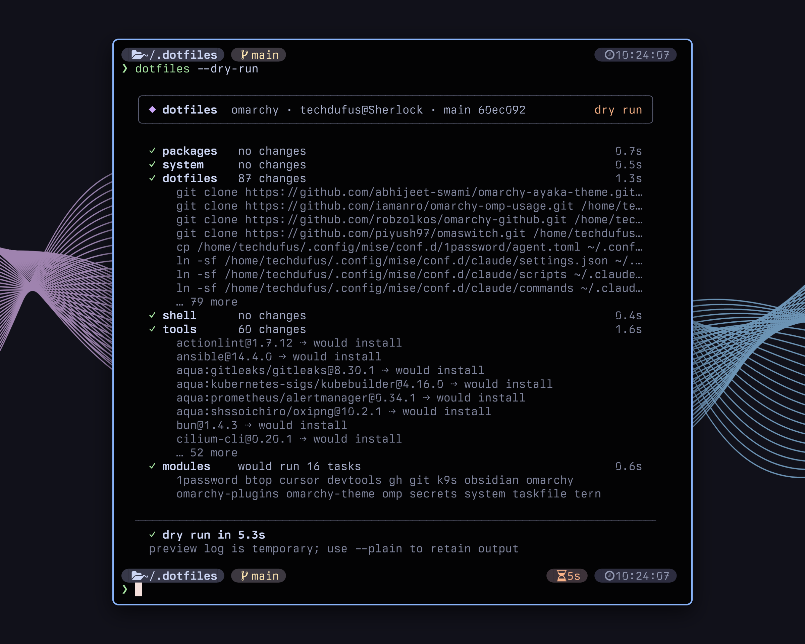
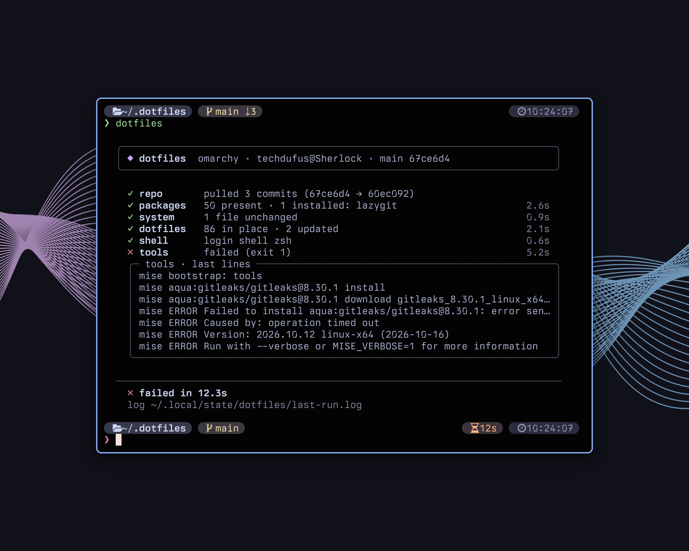

<div align="center">

<picture>
  <source media="(prefers-color-scheme: dark)" srcset=".github/assets/header-dark.png">
  
</picture>

**One command to converge a whole machine: Omarchy or macOS.**

<a href="https://github.com/TechDufus/dotfiles/actions/workflows/mise.yml"></a>
<a href="https://github.com/TechDufus/dotfiles/stargazers"></a>
<a href="https://github.com/TechDufus/dotfiles/commits/main"></a>
<a href="LICENSE"></a>


<a href="https://mise.jdx.dev"></a>

<a href="#bootstrap"><kbd> <br> Bootstrap <br> </kbd></a>&ensp;
<a href="#daily-use"><kbd> <br> Daily use <br> </kbd></a>&ensp;
<a href="#gallery"><kbd> <br> Gallery <br> </kbd></a>&ensp;
<a href="#keybindings"><kbd> <br> Keybindings <br> </kbd></a>&ensp;
<a href="#steal-this"><kbd> <br> Steal this <br> </kbd></a>&ensp;
<a href="#make-it-yours"><kbd> <br> Make it yours <br> </kbd></a>&ensp;

<br>



<em>The real <code>bin/dotfiles</code> UI converging Omarchy against a stubbed mise, next to this repo's Neovim and prompt, rendered by <a href=".github/assets/render/render.py"><code>render.py</code></a>.</em>

</div>

# dotfiles

My personal dotfiles, applied with [mise](https://mise.jdx.dev/bootstrap.html). **Omarchy and macOS are the supported profiles.**

| Profile | OS / session |
| --- | --- |
| `omarchy` | Omarchy (Hyprland), on laptops or desktops |
| `macos` | macOS (Apple Silicon) |

Profiles describe the operating system and session, not the chassis. The wrapper and Taskfile recognize Omarchy by OS ID or an installation at `~/.local/share/omarchy` or `/usr/share/omarchy`; an explicit `DOTFILES_PROFILE` takes precedence. On Omarchy, its native tooling owns the desktop and gaming stack.

Other systems stop with `unsupported machine`. The earlier Ansible provisioning version, which also covered Ubuntu, Fedora and WSL, is tagged [`ansible-final`](https://github.com/TechDufus/dotfiles/tree/ansible-final).

> [!NOTE]
> This is one person's machine, not a framework: it carries my identity, keymap and app choices. Take pieces from [Steal this](#steal-this), or fork the whole thing with [Make it yours](#make-it-yours).

## Highlights

- One command bootstraps a machine: `bin/dotfiles` installs git and mise, clones or pulls `~/.dotfiles`, links `conf.d` to `modules/`, records the profile and purpose, then runs mise bootstrap.
- In a terminal, the run goes one stage at a time (packages, system, dotfiles, shell, tools, modules) with a live summary, and mise's full output is kept in `~/.local/state/dotfiles/last-run.log`.
- Nothing in the way of a link gets overwritten: a conflicting target is preserved in a unique `<target>.pre-dotfiles.<epoch>.<random>/original` directory.
- Two profiles, `omarchy` and `macos`, describe the OS and session; the work or personal purpose is independent of them.
- Every module is one mise `conf.d` folder under `modules/`, with its config, bootstrap step and tests side by side.
- macOS and Omarchy share the same CapsLock summon leader: **CapsLock → t** for Tern and **CapsLock → Shift+T** for Ghostty.
- Module test suites (`test:*`) run in CI on Arch (Omarchy environment) and on macOS.

## Bootstrap

```bash
bash -c "$(curl -fsSL https://raw.githubusercontent.com/TechDufus/dotfiles/main/bin/dotfiles)"
```

> [!WARNING]
> That command is for my machines. Unchanged, it applies my Git and jj author name, my GitHub noreply address as the jj email and, on Omarchy, a Dvorak keymap and passwordless sudo. To run this setup yourself, fork it and follow [Make it yours](#make-it-yours) first.

<div align="center">

<br>
<em>The real UI against a stubbed mise, played back 2.5× faster; <a href=".github/assets/render/render.py"><code>render.py</code></a> records it.</em>
</div>



Nothing in the way of a link gets overwritten. Before replacing `~/.config/mise/conf.d` that isn't already a link to `~/.dotfiles/modules`, or a real file/directory that blocks a module's link (on a fresh Omarchy: its own ghostty, kitty and nvim configs, and omp's), the wrapper preserves it in a unique `<target>.pre-dotfiles.<epoch>.<random>/original` directory. Unexpected preview errors stop the run before conflict moves. These backups cover only conflicting link targets and `conf.d`, not a complete rollback: copies overwrite matching files without a backup, merges replace managed keys, and `absent` entries remove their targets. Review and preserve local differences before applying; save live edits to copied files first with `mise dot add`.

In a terminal, `dotfiles` runs those steps one stage at a time with a live summary, applies the dotfiles a second time when the first pass created files that other entries need, and keeps mise's full output in `~/.local/state/dotfiles/last-run.log`.

> [!TIP]
> Piped, or with `--plain`, `dotfiles` prints mise's own output and skips that second pass: on a fresh machine, run it twice.

## Daily use

| Command | Does |
| --- | --- |
| `dotfiles` | Pull the repo, then converge this machine |
| `dotfiles --dry-run` | Preview local modules without setup, pulling, or conflict moves; requires compatible mise already installed |
| `dotfiles --plain` | mise's own output instead of the summary (also when piped) |
| `dotfiles --purpose` | Print the effective work/personal purpose without setup |
| `dotfiles --set-purpose work` | Record work purpose and update mise discovery settings only; no provisioning |
| `dotfiles --set-purpose personal` | Switch back to personal without provisioning |
| `mise dot status` | Show the state of every managed file |
| `MISE_TASK_RUN_AUTO_INSTALL=false mise run check` | Dry run plus module tests; use the full validation command below from `~` |
| `update` | Profile-specific system upgrade: native `omarchy-update` or Homebrew |

<details>
<summary>Context, dry-run, and maintenance notes</summary>

The wrapper evaluates mise configuration and tasks from **HOME by default**, even when invoked inside another project. `DOTFILES_DIR` selects the source checkout, not the task context. An explicit `-C` / `--cd` deliberately selects another context for preview, bootstrap, and status, preserves paths relative to the caller's original directory, and selects plain mode. That project's tools, dotfiles, and tasks can then participate; use this override only intentionally.

Dry-run retains the configured global context when this checkout, profile, and purpose are already configured. First-run previews use scratch configuration; retained global configuration that cannot be represented faithfully causes an explicit refusal. If an older generated mise selection lacks purpose, run the config-only `dotfiles --set-purpose work` (or `personal`) first, then retry the preview. Preview never updates the live purpose or discovery settings. Custom `MISE_GLOBAL_CONFIG_FILE`/`MISE_CONFIG_FILE` selections are unsupported by the wrapper. Mise can still evaluate trusted templates and update metadata/state/caches: use isolated HOME/XDG/mise directories and filesystem confinement for experiments.

Taskfile maintenance follows the OS profile: Omarchy uses its native updater.

</details>

### Machine purpose

Purpose (`work` or `personal`) is independent of the OS profile and lives in a local, untracked marker; an unmarked machine is `personal`. `dotfiles --set-purpose` only saves the marker and regenerates mise's discovery settings: it never provisions. Purpose restricts packages through mise's native `env` option; so far only Discord is personal-only. The marker, the generated settings and how to inspect them are in [docs/purpose.md](docs/purpose.md).

## Gallery

<table>
  <tr>
    <td width="50%"></td>
    <td width="50%"></td>
  </tr>
  <tr>
    <td align="center"><em><code>dotfiles --dry-run</code> previews local modules without setup, pulling, or conflict moves.</em></td>
    <td align="center"><em>A failed stage stops the run and shows the last lines of its log.</em></td>
  </tr>
</table>

## Keybindings

### Mac bindings

Karabiner maps CapsLock to the Hammerspoon app leader: **tap CapsLock, then the app key** within one second. Shifted letters are distinct bindings. Escape or Control+C cancels the leader.

| App key | Application |
| --- | --- |
| `a` | Granola (Agenda) |
| `b` | Brave |
| `c` | Cursor |
| `Shift+C` | Signal |
| `d` | Discord |
| `e` | Outlook |
| `f` | Finder |
| `Shift+G` | GrokBot (launch only) |
| `h` | Screen Sharing |
| `s` | Spotify |
| `n` | Obsidian |
| `o` | 1Password |
| `m` | Teams (launch only) |
| `t` | Tern |
| **`Shift+T`** | **Ghostty** |
| **`w`** | **AWS WorkSpaces** (`com.amazon.workspaces`) |

`Hyper` means Command+Option+Control+Shift; `lilHyper` omits Shift.

| Shortcut | Window action |
| --- | --- |
| `Hyper+A` | Focus the frontmost application |
| `Hyper+P` | Pick a layout |
| `Hyper+;` / `Hyper+'` | Next layout variant / reset layout |
| `Command+U` | Bind the focused window to a cell |
| `Command+O` or `lilHyper+O` | Move the window to the next screen |
| `Command+Shift+O` or `Hyper+O` | Move the window to the previous screen |

Tap CapsLock twice, or F16 once, for the macro leader: `s` takes a screenshot to the clipboard, `e` opens the emoji picker, and `a` selects the next window of the current app. `b`, `t`, and `g` send the configured Raycast bookmark, tab, and GIF-search chords; those integrations require matching Raycast actions.

### Omarchy screens

Super stands in for Command. As on the Mac, each screen has a layout of cells, and each app has a cell in every layout.

| Shortcut | Window action |
| --- | --- |
| `Super+O` or `Super+Control+Alt+O` | Move the window to the next screen, into its cell there |
| `Super+Shift+O` or `Super+Control+Alt+Shift+O` | Move the window to the previous screen |
| `Super+U` | Pick the app's cell on this screen; each screen remembers its own choice. The last cell of every cell layout is full screen |
| `Super+Control+Alt+Shift+P` / `;` / `'` | Pick, cycle, or reset this screen's layout |
| `Super+L` | Toggle the workspace between cells and full screen |
| `Alt+Tab` / `Alt+Shift+Tab` | OmaSwitch window switcher (most recent windows first, type to search); without the plugin, cycle windows on the workspace |

How cells treats floating, fullscreen and game windows, the two-monitor desk, and the CapsLock/F13 leader on Omarchy: [docs/omarchy.md](docs/omarchy.md#cells-and-screens).

## Steal this

Most of this repo is only useful to me, but these parts stand on their own. Each is a file or two you can read and lift without taking the rest.

| Idea | Where it lives |
| --- | --- |
| Cell layouts for Hyprland: every screen has a layout of cells, and every app has a cell in each layout | [`cells.lua`](modules/omarchy/hypr/cells.lua), [`layouts.lua`](modules/omarchy/hypr/layouts.lua) |
| The same layouts on macOS, through Hammerspoon | [`modules/hammerspoon/config/`](modules/hammerspoon/config), [WorkspaceManager.spoon](https://github.com/TechDufus/WorkspaceManager.spoon) |
| One CapsLock leader that summons apps on both systems | [`summon.lua`](modules/omarchy/hypr/summon.lua), [`summon_apps.lua`](modules/omarchy/hypr/summon_apps.lua), [`karabiner.json`](modules/hammerspoon/karabiner/karabiner.json) |
| Wine and Proton games that stay tiled and stop pulling focus back | [`games.lua`](modules/omarchy/hypr/games.lua), [`layouts.lua`](modules/omarchy/hypr/layouts.lua) |
| A staged progress screen over `mise bootstrap`, with the full log kept | [`bin/dotfiles`](bin/dotfiles) |
| Files that block a link are moved aside, never overwritten | [`bin/dotfiles`](bin/dotfiles) |
| Work and personal machines from one repo, using mise environments | [docs/purpose.md](docs/purpose.md) |
| Sudoers installed only after `visudo` accepts the staged file | [`modules/system/bootstrap.sh`](modules/system/bootstrap.sh), [its test](modules/system/tests/test_sudoers.sh) |
| One owned include block in a `~/.gitconfig` that other tools also write | [`modules/git/bootstrap.py`](modules/git/bootstrap.py) |
| SSH keys, signing data and fonts synced from 1Password, rewritten only when they differ | [`modules/secrets/bootstrap.sh`](modules/secrets/bootstrap.sh) |
| Shell secrets read from 1Password on demand and kept in a local cache | [`vars.secret_functions.zsh`](modules/zsh/zsh/vars.secret_functions.zsh) |
| README images rendered from the real CLI against a stubbed mise | [`.github/assets/render/`](.github/assets/render) |
| Module tests in CI on Arch and macOS | [`mise.yml`](.github/workflows/mise.yml) |

## Make it yours

Forking works, but there is no settings layer: a fork edits files. Before the first run, change:

- `REPO_URL` in `bin/dotfiles`, or your one-liner installs this repo instead of your fork.
- The Git, jj and npm author names, and the 1Password account and item references behind the email, SSH keys, signing and fonts.
- On Omarchy, the Dvorak keymap and the passwordless sudo policy in `modules/system/bootstrap.sh`.

Then delete the module folders you don't want and preview with `dotfiles --dry-run`. [docs/fork.md](docs/fork.md) lists every personal value and where it lives.

There are no releases and no compatibility promise: `main` is whatever my machines run today.

## Validation

Run the gate from HOME so an unrelated project's config or `check` task cannot shadow the dotfiles:

```bash
cd ~ &&
  MISE_TASK_RUN_AUTO_INSTALL=false MISE_AUTO_ENV=true \
  DOTFILES_TEST_REAL_MISE="$(command -v mise)" mise run check
```

Set `MISE_TASK_RUN_AUTO_INSTALL=false` **before** the outer `mise run` starts; setting it inside a task is too late to prevent tool installation. This invocation does not disable normal auto-install globally. `DOTFILES_TEST_REAL_MISE` must name a trusted, compatible installed mise executable; it enables the native source-relative preview fixture without installing or applying dotfiles.

Install the gate's prerequisites separately before running it: Git, Bash, Zsh, Lua, Bun, jq, Python 3, and the platform's standard utilities. macOS CI runs every loaded `test:*` module suite from HOME with the same native fixture enabled, not just the Hammerspoon suite.

A dry run or a macOS-hosted Linux profile-selection check is not native Linux runtime verification. Check the relevant Omarchy services, desktop/session behavior, and optional task outcomes on that OS; do not treat macOS CI as proof that all Linux paths ran.

<details>
<summary>Linux sudoers regression gate</summary>

The separate Linux sudoers regression gate is not part of the wildcard module suites:

```bash
cd ~ &&
  MISE_TASK_RUN_AUTO_INSTALL=false MISE_AUTO_ENV=true mise run check:system-sudoers
```

It requires a non-root Linux account, installed `visudo`, bubblewrap, permitted unprivileged user/PID namespaces, and an existing `/etc/sudoers.d`. It maps a disposable policy directory and does not invoke real sudo or write a live grant. Run it on a suitable Linux executor; namespace restrictions are a reported failure, not proof that the policy passed.

The workflow defines a dedicated `system-sudoers` Ubuntu job that installs packaged sudo/bubblewrap, loads an AppArmor profile that grants user namespaces to `/usr/bin/bwrap` only (Ubuntu 24.04 otherwise blocks them for unprivileged programs; the host-wide restriction stays on), and runs the same test script directly as the non-root runner account, outside the wildcard suites. This route covers isolated sudoers safety, not full Omarchy provisioning or desktop runtime; consult the workflow results for execution evidence.

</details>

## Documentation

| Page | Covers |
| --- | --- |
| [Make it yours](docs/fork.md) | Every personal value a fork has to change, and how to preview safely |
| [Machine purpose](docs/purpose.md) | The work/personal marker, the generated mise settings, package restrictions |
| [Omarchy desktop](docs/omarchy.md) | How cells places windows, the two-monitor desk, shell plugins, liquidctl, Battle.net |
| [Apps](docs/apps.md) | OMP model routing and skills, Tern, Tailscale, Moonlight |
| [Migration notes](docs/migration.md) | Changes for machines that ran the Ansible version or carry state from retired modules |

## Layout

```text
bin/dotfiles          bootstrap + wrapper (curl entrypoint)
modules/<name>/       one mise conf.d folder per module
  mise.toml           every supported profile
  mise.linux.toml     Linux (Omarchy)
  mise.macos.toml     macOS
  mise.omarchy.toml   Omarchy / Hyprland
  <config files>, bootstrap.sh, tests/
docs/                 fork guide and reference notes
.github/assets/       README images; render/render.py regenerates them
```

[AGENTS.md](AGENTS.md) has the rules for changing modules.

## Star history

<a href="https://www.star-history.com/#techdufus/dotfiles&Date">
  <picture>
    <source media="(prefers-color-scheme: dark)" srcset="https://api.star-history.com/svg?repos=techdufus/dotfiles&type=Date&theme=dark">
    
  </picture>
</a>

## License

Apache-2.0, see [LICENSE](LICENSE).
