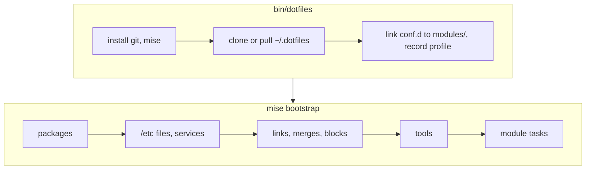

<div align="center">


[](https://github.com/TechDufus/dotfiles/actions/workflows/mise.yml)

</div>

# dotfiles

My personal dotfiles, applied with [mise](https://mise.jdx.dev/bootstrap.html) on three machines:

| Machine | Profile | Desktop |
| --- | --- | --- |
| Laptop | `omarchy` | Omarchy (Hyprland) |
| Desktop | `cachyos` | CachyOS (KDE Plasma, Steam) |
| MacBook | `macos` | macOS (Apple Silicon) |

Other systems stop with `unsupported machine`. The earlier Ansible version, which also covered Ubuntu, Fedora and WSL, is tagged [`ansible-final`](https://github.com/TechDufus/dotfiles/tree/ansible-final).

> [!NOTE]
> Public for reference, not as a framework. Read before you borrow.

## Bootstrap

```bash
bash -c "$(curl -fsSL https://raw.githubusercontent.com/TechDufus/dotfiles/main/bin/dotfiles)"
```



Nothing in the way of a link gets overwritten. Before replacing `~/.config/mise/conf.d` that isn't already a link to `~/.dotfiles/modules`, or a real file/directory that blocks a module's link (on a fresh Omarchy: its own ghostty, kitty and nvim configs, and omp's), the wrapper preserves it in a unique `<target>.pre-dotfiles.<epoch>.<random>/original` directory. Unexpected preview errors stop the run before conflict moves. These backups cover only conflicting link targets and `conf.d`, not a complete rollback: copies overwrite matching files without a backup, merges replace managed keys, and `absent` entries remove their targets. Review and preserve local differences before applying; save live edits to copied files first with `mise dot add`.

In a terminal, `dotfiles` runs those steps one stage at a time with a live summary, applies the dotfiles a second time when the first pass created files that other entries need, and keeps mise's full output in `~/.local/state/dotfiles/last-run.log`.

> [!TIP]
> Piped, or with `--plain`, `dotfiles` prints mise's own output and skips that second pass: on a fresh machine, run it twice.

## Daily use

| Command | Does |
| --- | --- |
| `dotfiles` | Pull the repo, then converge this machine |
| `dotfiles --dry-run` | Preview local modules without setup, pulling, or conflict moves; requires compatible mise already installed |
| `dotfiles --plain` | mise's own output instead of the summary (also when piped) |
| `mise dot status` | Show the state of every managed file |
| `mise run check` | Dry run plus module tests (run it from `~`) |
| `update` | Full system upgrade (`omarchy update`, `paru -Syu`, or Homebrew) |

Dry-run keeps the original configuration context when this checkout and profile are already configured. First-run previews use scratch configuration; retained global configuration that cannot be represented faithfully causes an explicit refusal. Custom `MISE_GLOBAL_CONFIG_FILE`/`MISE_CONFIG_FILE` selections are unsupported by the wrapper. Mise can still evaluate trusted templates and update metadata/state/caches: use isolated HOME/XDG/mise directories and filesystem confinement for experiments.

## MacBook migration

- Existing stable Raycast is preserved, including hand-installed copies; the stable Homebrew cask is installed only when the app is absent. The migration neither installs Beta nor deletes stable.
- Existing sudo policy is left untouched. Privileged changes can still require authentication.
- The 1Password SSH agent selects only `Personal` on macOS; other profiles retain their shared selections.
- Claude uses a Mac-specific, symlinked settings source containing only theme and TUI. It does not enable the shared permission/plugin/hook profile. The Herdr-generated session hook is neither carried forward nor registered.
- Hammerspoon retains Tern on uppercase `T`. Spoon updates validate both releases before replacement, restore prior installations on failure/interruption, and leave unchanged installs untouched. If restoration fails, the reported transaction directory retains the originals.
- Shell paths preserve existing optional local CLIs while prioritizing intentional local wrappers and mise runtimes. pnpm uses native upstream releases rather than npm lifecycle scripts.
- Vimscript language-server installation is no longer managed. An existing Bun-global `vim-language-server` must be removed during an approved cutover if OMP's built-in discovery should stop finding it; Vim syntax parsers remain available.

For an Ansible cutover, use a plain terminal and a fixed reviewed revision. Preserve the unique local commits, copied/merged configurations, ignored Neovim lockfile, and dropped-role configuration before switching branches. Review Git include precedence and executable ownership before cleanup. Do not delete `roles/` or force conflicts before every original is recoverable.

Relink configurations before broader provisioning, run again to settle permissions on merge-created files, then require clean `mise dot status --missing` and a no-change repeat. Verify signing, service health, actual application behavior, and any fail-soft task outcomes separately. A Git checkout reversal does not undo installed tools, services, shell registration, copies, or merges; preserve a verified private rollback snapshot rather than treating the old issue runbook as a transaction.

## Layout

```text
bin/dotfiles          bootstrap + wrapper (curl entrypoint)
modules/<name>/       one mise conf.d folder per module
  mise.toml           every machine
  mise.linux.toml     Omarchy + CachyOS
  mise.macos.toml     MacBook
  mise.omarchy.toml   laptop only
  mise.cachyos.toml   desktop only
  <config files>, bootstrap.sh, tests/
```

[AGENTS.md](AGENTS.md) has the rules for changing modules.
