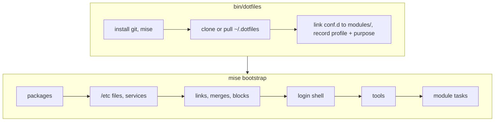

<div align="center">


[](https://github.com/TechDufus/dotfiles/actions/workflows/mise.yml)

</div>

# dotfiles

My personal dotfiles, applied with [mise](https://mise.jdx.dev/bootstrap.html). **Omarchy and macOS are the primary profiles; CachyOS remains supported.**

| Profile | OS / session |
| --- | --- |
| `omarchy` | Omarchy (Hyprland), on laptops or desktops |
| `macos` | macOS (Apple Silicon) |
| `cachyos` | CachyOS (KDE Plasma) |

Profiles describe the operating system and session, not the chassis. The wrapper and Taskfile recognize Omarchy by OS ID or an installation at `~/.local/share/omarchy` or `/usr/share/omarchy`; an explicit `DOTFILES_PROFILE` takes precedence. On Omarchy, its native tooling owns the desktop and gaming stack; CachyOS-specific gaming, KDE, and GPU policy is not automatically migrated.

Other systems stop with `unsupported machine`. The earlier Ansible provisioning version, which also covered Ubuntu, Fedora and WSL, is tagged [`ansible-final`](https://github.com/TechDufus/dotfiles/tree/ansible-final).

> [!NOTE]
> Public for reference, not as a framework. Read before you borrow.

## Bootstrap

```bash
bash -c "$(curl -fsSL https://raw.githubusercontent.com/TechDufus/dotfiles/main/bin/dotfiles)"
```



Nothing in the way of a link gets overwritten. Before replacing `~/.config/mise/conf.d` that isn't already a link to `~/.dotfiles/modules`, or a real file/directory that blocks a module's link (on a fresh Omarchy: its own ghostty, kitty and nvim configs, and omp's), the wrapper preserves it in a unique `<target>.pre-dotfiles.<epoch>.<random>/original` directory. Unexpected preview errors stop the run before conflict moves. These backups cover only conflicting link targets and `conf.d`, not a complete rollback: copies overwrite matching files without a backup, merges replace managed keys, and `absent` entries remove their targets. Review and preserve local differences before applying; save live edits to copied files first with `mise dot add`.

In a terminal, `dotfiles` runs those steps one stage at a time with a live summary, applies the dotfiles a second time when the first pass created files that other entries need, and keeps mise's full output in `~/.local/state/dotfiles/last-run.log`.

> [!TIP]
> Piped, or with `--plain`, `dotfiles` prints mise's own output and skips that second pass: on a fresh machine, run it twice.

## Daily use

| Command | Does |
| --- | --- |
| `dotfiles` | Pull the repo, then converge this machine |
| `dotfiles --dry-run` | Preview local modules without setup, pulling, or conflict moves; requires compatible mise already installed |
| `dotfiles --plain` | mise's own output instead of the summary (also when piped) |
| `dotfiles --purpose` | Print the effective work/personal purpose without setup |
| `dotfiles --set-purpose work` | Record work purpose and update mise discovery settings only; no provisioning |
| `dotfiles --set-purpose personal` | Switch back to personal without provisioning |
| `mise dot status` | Show the state of every managed file |
| `MISE_TASK_RUN_AUTO_INSTALL=false mise run check` | Dry run plus module tests; use the full validation command below from `~` |
| `update` | Profile-specific system upgrade: native `omarchy-update`, CachyOS package tasks, or Homebrew |

The wrapper evaluates mise configuration and tasks from **HOME by default**, even when invoked inside another project. `DOTFILES_DIR` selects the source checkout, not the task context. An explicit `-C` / `--cd` deliberately selects another context for preview, bootstrap, and status, preserves paths relative to the caller's original directory, and selects plain mode. That project's tools, dotfiles, and tasks can then participate; use this override only intentionally.

Dry-run retains the configured global context when this checkout, profile, and purpose are already configured. First-run previews use scratch configuration; retained global configuration that cannot be represented faithfully causes an explicit refusal. If an older generated mise selection lacks purpose, run the config-only `dotfiles --set-purpose work` (or `personal`) first, then retry the preview. Preview never updates the live purpose or discovery settings. Custom `MISE_GLOBAL_CONFIG_FILE`/`MISE_CONFIG_FILE` selections are unsupported by the wrapper. Mise can still evaluate trusted templates and update metadata/state/caches: use isolated HOME/XDG/mise directories and filesystem confinement for experiments.

Taskfile maintenance follows the OS profile: Omarchy uses its native updater. CachyOS retains its package/AUR maintenance, cache cleanup, and Plasma/Steam desktop-health checks; those CachyOS-only consumers are not installed or run on Omarchy.

### Machine purpose

Purpose is independent of the OS profile: any supported profile can be `work` or `personal`. An unmarked machine defaults to `personal`, preserving the usual setup on other machines. The local, untracked marker is `${XDG_CONFIG_HOME:-$HOME/.config}/dotfiles/purpose`; invalid or empty stored values stop the wrapper before provisioning rather than silently selecting personal.

`dotfiles --set-purpose work` and `dotfiles --set-purpose personal` only save that marker and regenerate mise discovery settings. They do not install prerequisites, sync the repo, replace `conf.d`, move conflicts, run tasks, or apply packages/dotfiles. Run the setter on its own, not with bootstrap flags such as `--dry-run`. `dotfiles --purpose` is a read-only query of the effective purpose.

The wrapper owns generated `${XDG_CONFIG_HOME:-$HOME/.config}/mise/miserc.local.toml`; do not hand-edit purpose there. The setter and normal setup keep `auto_env = true` and persist `env = ["work"]` (or `["personal"]`) on macOS, and `env = ["omarchy", "work"]` / `["cachyos", "work"]` on Linux (substitute `personal` when selected). Subsequent raw mise commands use this persisted selection; a marker alone does not configure raw mise before the setter or normal setup has generated it.

Package restrictions use mise's native [`[bootstrap.packages]` `env` option](https://mise.jdx.dev/bootstrap/packages/#by-config-environment): `env = "work"` is work-only, `env = "personal"` is personal-only, and omitting `env` is shared, still subject to the existing platform/profile declarations. Discord is personal-only on macOS and Linux; all other app declarations and shared shortcuts are unchanged. Selecting work does **not uninstall** an existing Discord installation or disable its shortcuts.

This is an installation preference, not an allowlist or organizational/security enforcement. It does not restrict unrelated apps installed by bootstrap tasks or external installers; any future restriction on those apps must also cover their installer/configuration owner. Explicit native `MISE_ENV` or `mise -E` selections can intentionally override generated environments; preserve the distro environment when doing so on Linux.

Read-only inspection from HOME, with compatible mise and existing package-manager prerequisites:

```bash
cd ~
dotfiles --purpose
mise bootstrap packages status --json
# macOS: compare requested packages without changing the saved purpose.
MISE_AUTO_ENV=true mise -E work bootstrap packages status --json
MISE_AUTO_ENV=true mise -E personal bootstrap packages status --json
# Linux: retain the actual distro environment (use cachyos instead if applicable).
MISE_AUTO_ENV=true mise -E omarchy,work bootstrap packages status --json
MISE_AUTO_ENV=true mise -E omarchy,personal bootstrap packages status --json
```

[`status`](https://mise.jdx.dev/cli/bootstrap/packages/status.html) does not install packages or use sudo. Discord should be absent from the work request and present in the personal control; shared package requests should remain unchanged. A work status does not prove Discord is absent from the machine, and cross-platform selection on macOS is not native Linux runtime verification.

## Validation

Run the gate from HOME so an unrelated project's config or `check` task cannot shadow the dotfiles:

```bash
cd ~ &&
  MISE_TASK_RUN_AUTO_INSTALL=false MISE_AUTO_ENV=true \
  DOTFILES_TEST_REAL_MISE="$(command -v mise)" mise run check
```

Set `MISE_TASK_RUN_AUTO_INSTALL=false` **before** the outer `mise run` starts; setting it inside a task is too late to prevent tool installation. This invocation does not disable normal auto-install globally. `DOTFILES_TEST_REAL_MISE` must name a trusted, compatible installed mise executable; it enables the native source-relative preview fixture without installing or applying dotfiles.

Install the gate's prerequisites separately before running it: Git, Bash, Zsh, Lua, Bun, jq, Python 3, and the platform's standard utilities. macOS CI runs every loaded `test:*` module suite from HOME with the same native fixture enabled, not just the Hammerspoon suite.

A dry run or a macOS-hosted Linux profile-selection check is not native Linux runtime verification. Check the relevant Omarchy or CachyOS services, desktop/session behavior, and optional task outcomes on that OS; do not treat macOS CI as proof that all Linux paths ran.

The separate Linux sudoers regression gate is not part of the wildcard module suites:

```bash
cd ~ &&
  MISE_TASK_RUN_AUTO_INSTALL=false MISE_AUTO_ENV=true mise run check:system-sudoers
```

It requires a non-root Linux account, installed `visudo`, bubblewrap, permitted unprivileged user/PID namespaces, and an existing `/etc/sudoers.d`. It maps a disposable policy directory and does not invoke real sudo or write a live grant. Run it on a suitable Linux executor; namespace restrictions are a reported failure, not proof that the policy passed.

The workflow defines a dedicated `system-sudoers` Ubuntu job that installs packaged sudo/bubblewrap and runs the same test script directly as the non-root runner account, outside the wildcard suites. It does not weaken host namespace restrictions. This route covers isolated sudoers safety, not full Omarchy/CachyOS provisioning or desktop runtime; consult the workflow results for execution evidence.

## macOS migration

- Existing stable Raycast is preserved, including hand-installed copies; the stable Homebrew cask is installed only when the app is absent. The migration neither installs Beta nor deletes stable.
- Existing sudo policy is left untouched. Privileged changes can still require authentication.
- The 1Password SSH agent selects only `Personal` on macOS; other profiles retain their shared selections.
- Claude uses a Mac-specific, symlinked settings source containing only theme and TUI. It does not enable the shared permission/plugin/hook profile. The Herdr-generated session hook is neither carried forward nor registered.
- Hammerspoon retains Tern on uppercase `T`. Spoon updates validate both releases before replacement, restore prior installations on failure/interruption, and leave unchanged installs untouched. If restoration fails, the reported transaction directory retains the originals.
- Tern's macOS profile disables the press-and-hold accent menu for `so.stencil.tern` so held letters and numbers can repeat. Global repeat timing and other apps are unchanged. Fully quit and reopen Tern after applying this preference; reloading its settings alone is insufficient.
- On macOS, mise shims take precedence over local CLI installations, including app-owned launchers such as Tern's `omp`. Login Zsh restores this order after Apple's `path_helper`. Linux keeps its intentional local-wrapper-first order; optional CLI paths remain available on both platforms. pnpm uses native upstream releases rather than npm lifecycle scripts.
- Vimscript language-server installation is no longer managed. An existing Bun-global `vim-language-server` must be removed during an approved cutover if OMP's built-in discovery should stop finding it; Vim syntax parsers remain available.
- Yazi's Mac profile owns its config and theme; its current built-in keymap replaces the empty legacy keymap. Obsolete Plasma, rofimoji, and OpenCode companion links are retired only on macOS.
- Neovim generates a new ignored `lazy-lock.json` from its configured plugins instead of carrying forward the old role's lock. macOS declares Ruby for Mason's Solargraph and selects it inside Neovim without changing the shell's Ruby. Go-tool builds report installation failures rather than completing before their installers.
- Neovim's shared theme explicitly selects Catppuccin Mocha, with transparent editing areas and ordinary floating windows rather than near-black overrides. It inherits the terminal background; window opacity remains a terminal setting, and selections/statuslines retain their own contrast.
- The global TypeScript compiler remains on `latest`. TypeScript language-server 6 carries a private compatible SDK 6 through its mise postinstall hook, without adding competing compiler executables.

### Mac bindings

Karabiner maps CapsLock to the Hammerspoon app leader: **tap CapsLock, then the app key** within one second. Shifted letters are distinct bindings. Escape or Control+C cancels the leader.

| App key | Application |
| --- | --- |
| `a` | Granola (Agenda) |
| `b` | Brave |
| `c` | Cursor |
| `Shift+C` | Signal |
| `d` | Discord |
| `e` | Outlook |
| `f` | Finder |
| `Shift+G` | GrokBot (launch only) |
| `h` | Screen Sharing |
| `s` | Spotify |
| `n` | Obsidian |
| `o` | 1Password |
| `m` | Teams (launch only) |
| `t` | Ghostty |
| **`Shift+T`** | **Tern** |
| **`w`** | **AWS WorkSpaces** (`com.amazon.workspaces`) |

`Hyper` means Command+Option+Control+Shift; `lilHyper` omits Shift.

| Shortcut | Window action |
| --- | --- |
| `Hyper+A` | Focus the frontmost application |
| `Hyper+P` | Pick a layout |
| `Hyper+;` / `Hyper+'` | Next layout variant / reset layout |
| `Command+U` | Bind the focused window to a cell |
| `Command+O` or `lilHyper+O` | Move the window to the next screen |
| `Command+Shift+O` or `Hyper+O` | Move the window to the previous screen |

Tap CapsLock twice, or F16 once, for the macro leader: `s` takes a screenshot to the clipboard, `e` opens the emoji picker, and `a` selects the next window of the current app. `b`, `t`, and `g` send the configured Raycast bookmark, tab, and GIF-search chords; those integrations require matching Raycast actions.

### Tern

Native mise merges and the bootstrap reset both use the standard Tern roots: `~/Library/Application Support/Tern` on macOS and `~/.config/tern` on Linux. `TERN_CONFIG_DIR` and a custom `XDG_CONFIG_HOME` are not supported by this module; the old role's alternate-root behavior is not carried forward.

Tern shares dark Catppuccin styling, Float layout, Glass material, vertical tabs, BerkeleyMono Nerd Font, copy-on-select, and the Console chat style (`surface_chat`). Bootstrap removes the legacy explicit opacity override so Tern's default applies. Use **Reload settings (`Control+Shift+F5`)** after settings cleanup; the macOS held-key-repeat preference above instead requires a full quit and reopen.

The launch keys intentionally differ: **CapsLock → Shift+T** opens Tern on macOS; **CapsLock → t** opens it on Omarchy, where Shift+T opens Ghostty. Linux-only pane keys are `Control+]` / `Control+[` for next/previous pane and `Control+Alt+]` / `Control+Alt+[` for next/previous tab across sessions.

## Omarchy screens

Super stands in for Command. As on the Mac, each screen has a layout of cells, and each app has a cell in every layout.

| Shortcut | Window action |
| --- | --- |
| `Super+O` or `Super+Control+Alt+O` | Move the window to the next screen, into its cell there |
| `Super+Shift+O` or `Super+Control+Alt+Shift+O` | Move the window to the previous screen |
| `Super+U` | Pick the app's cell on this screen; each screen remembers its own choice |
| `Super+Control+Alt+Shift+P` / `;` / `'` | Pick, cycle, or reset this screen's layout |
| `Super+L` | Toggle the workspace between cells and full screen |

Floating windows that cells does not place, such as dialogs, keep their position and size relative to the screen. Moving a window you tiled with `Super+T` puts it back in its cell. Fullscreen windows stay fullscreen; they return to their cell when they leave fullscreen. `Super+O` and `Super+Shift+O` replace Omarchy's pop-out and Obsidian bindings. Use CapsLock → `n` to summon Obsidian.

The summon leader is CapsLock or F13, as on the Mac (Karabiner turned CapsLock into F13) and on CachyOS (keyd accepted both). A keyboard that sends F13 from its Caps Lock key needs no remap.

`modules/omarchy/hypr/monitors.lua` sets up the desk with the Acer VG281K 4K and the HP P224 1080p. The HP is on the left, the 4K is main, and the cursor starts there at login. Workspaces 1–3 (terminal, browser, Obsidian) live on the 4K, and workspaces 4–5 (chat, music) on the HP. The HP defaults to the Fullscreen layout. These rules match the panels by description, and the workspace bindings apply only while both panels are connected, so other machines are unaffected.

## Migration ownership and rollback

- Ansible is retained as a development-tool dependency for the Ansible language server, not as the provisioning engine. macOS owns standalone Ansible through Homebrew; Linux owns `ansible-core` and `ansible-lint` through pacman. The existing macOS Neovim profile also owns `ansible-lint`.
- `bootstrap:git` places one owned include block at the end of `~/.gitconfig`, after historical globals. After successful migration, defaults and the generated `~/.config/git/identity.gitconfig` are loaded once; macOS also includes its platform defaults. Explicit repository-local settings still win. Cleanup removes only exact obsolete `dotfiles` / `dotfiles-macos` blocks from `~/.config/git/config` (or an active XDG config root within HOME), preserving unrelated contents and both global files. This transfers ownership without requiring a change to an already-correct identity.
- Helm bootstrap requires the canonical `traefik` name to point at its required repository URL. It repairs a missing or incorrect alias without a broad repository update; optional Helm failures still warn and skip.
- Retired Ollama helpers are not deleted automatically. If `~/.config/ollama/Modelfile.qwen-omp` or `~/.local/bin/ollama-qwen`, `ollama-qwen-start`, or `ollama-qwen-stop` remain, review their contents and consumers before manually removing obsolete copies. Customized files or replacement symlinks must not be treated as known historical files.
- The retired `sesh` popup (`prefix+o`) is removed from the managed tmux config instead of reinstalling its provider. Omarchy's native tmux configuration remains outside this module's ownership.
- Linux passwordless sudo policy is derived from the actual invoking non-root UID, not `$USER` or a root fallback. `bootstrap:system` protects and validates a root-owned `0440` candidate with real `visudo` before atomic installation, rejects symlink/non-regular destinations, and fails before later udev/keyboard steps if validation or installation fails. Other policy files and macOS sudo policy are left alone.

Git include placement is task-owned: `mise dot apply` / `status` cover the linked source files but do not perform or verify the include migration. After applying those sources, use full bootstrap or the targeted task:

```bash
cd ~ && MISE_TASK_RUN_AUTO_INSTALL=false mise run bootstrap:git
```

Python 3 is required. The task warns and skips changed/damaged owned blocks, unsafe/shared files or parents, lock files, or an explicit `GIT_CONFIG_GLOBAL` redirect; inspect its outcome rather than assuming a green dotfile status proves Git ownership.

The new validated include owner is published **before** obsolete includes are removed, so interruption does not remove the signing policy. If cleanup fails after publication, temporary duplicate includes can remain. Review the warning and rerun `bootstrap:git` to complete cleanup and restore single loading; do not delete a global config file to recover.

After an authorized apply on **native Linux**, validate the installed sudoers include graph and file metadata before considering the system step complete:

```bash
sudo visudo -cf /etc/sudoers
sudo stat -c '%U:%G:%a' /etc/sudoers.d/techdufus
sudo -l
```

Expect `root:root:440` for the managed file and review the invoking account's effective policy. Run bootstrap as the normal user, not root. These post-apply checks complement, rather than replace, the automatic pre-install candidate validation.

For an Ansible cutover, use a plain terminal and a fixed reviewed revision. Preserve unique local commits, copied/merged configurations, and any retired-role configuration you intend to keep before switching branches. Retiring the old `roles/` source tree is not an instruction to delete its former live configuration wholesale: review each local file and its current owner. Remove redundant public CLI installations only after checking consumers; app-owned runtimes such as Tern's OMP and a Bun binary used by a LaunchAgent may still be required.

Relink configurations before broader provisioning, run again to settle permissions on merge-created files, then require clean `mise dot status --missing` and a no-change repeat. Verify signing, service health, actual application behavior, and any fail-soft task outcomes separately. A Git checkout reversal does not undo installed tools, services, shell registration, copies, merges, or removals; preserve a verified private rollback snapshot of the affected live configuration and ownership rather than treating a branch switch as a transaction.

## Layout

```text
bin/dotfiles          bootstrap + wrapper (curl entrypoint)
modules/<name>/       one mise conf.d folder per module
  mise.toml           every supported profile
  mise.linux.toml     Omarchy + CachyOS
  mise.macos.toml     macOS
  mise.omarchy.toml   Omarchy / Hyprland
  mise.cachyos.toml   CachyOS / KDE Plasma
  <config files>, bootstrap.sh, tests/
```

[AGENTS.md](AGENTS.md) has the rules for changing modules.
