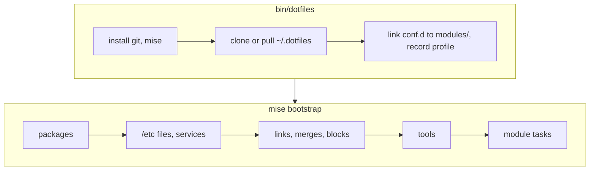

<div align="center">


[](https://github.com/TechDufus/dotfiles/actions/workflows/mise.yml)

</div>

# dotfiles

My personal dotfiles, applied with [mise](https://mise.jdx.dev/bootstrap.html) on three machines:

| Machine | Profile | Desktop |
| --- | --- | --- |
| Laptop | `omarchy` | Omarchy (Hyprland) |
| Desktop | `cachyos` | CachyOS (KDE Plasma, Steam) |
| MacBook | `macos` | macOS (Apple Silicon) |

Other systems stop with `unsupported machine`. The earlier Ansible version, which also covered Ubuntu, Fedora and WSL, is tagged [`ansible-final`](https://github.com/TechDufus/dotfiles/tree/ansible-final).

> [!NOTE]
> Public for reference, not as a framework. Read before you borrow.

## Bootstrap

```bash
bash -c "$(curl -fsSL https://raw.githubusercontent.com/TechDufus/dotfiles/main/bin/dotfiles)"
```



An existing `~/.config/mise/conf.d` that isn't already a link to `~/.dotfiles/modules` is moved to `conf.d.pre-dotfiles.<timestamp>` first.

> [!TIP]
> On a fresh machine, run `dotfiles` twice: some permissions and identity files apply only after the first run creates them.

## Daily use

| Command | Does |
| --- | --- |
| `dotfiles` | Pull the repo, then converge this machine |
| `dotfiles --dry-run` | Preview every change |
| `mise dot status` | Show the state of every managed file |
| `mise run check` | Dry run plus module tests (run it from `~`) |
| `update` | Full system upgrade (`omarchy update`, `paru -Syu`, or Homebrew) |

## Layout

```text
bin/dotfiles          bootstrap + wrapper (curl entrypoint)
modules/<name>/       one mise conf.d folder per module
  mise.toml           every machine
  mise.linux.toml     Omarchy + CachyOS
  mise.macos.toml     MacBook
  mise.omarchy.toml   laptop only
  mise.cachyos.toml   desktop only
  <config files>, bootstrap.sh, tests/
```

[AGENTS.md](AGENTS.md) has the rules for changing modules.
